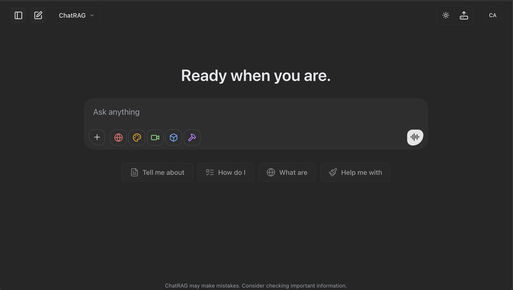

#  ChatRAG - Production-Ready AI Chatbot Platform

<div align="center">
  <h3>Build Unlimited RAG-Powered AI Chatbots in Minutes</h3>

  [](https://nextjs.org)
  [](https://react.dev)
  [](https://typescriptlang.org)
  [](https://supabase.com)
  [](https://openrouter.ai)
  [](LICENSE)

  <p align="center">
    <strong>Visual Config UI</strong> •
    <strong>15-28x Faster Search</strong> •
    <strong>100+ AI Models</strong> •
    <strong>WhatsApp Ready</strong>
  </p>

  [📚 Docs](#-documentation) • [🚀 Deploy](#-quick-start) • [💬 Discord](https://discord.gg/QYESpZvU)
</div>

---

<div align="center">
  
  <p><em>ChatRAG's beautiful, modern chat interface with dark mode support</em></p>
</div>

---

## ⚠️ IMPORTANT: Choose Your Deployment Mode First

**Before setup, decide which architecture fits your use case.** ChatRAG supports two modes with the same codebase:

<table>
<tr>
<td width="50%" align="center">

### 🏢 Single-Tenant Mode
**One Knowledge Base, Multiple Users**

```
┌─────────────────────────┐
│   Application           │
├─────────────────────────┤
│ Shared Knowledge Base   │
│ (All users access same  │
│  documents)             │
├─────────────────────────┤
│ User A │ User B │ User C│
│ Chats  │ Chats  │ Chats │
│(Private)│(Private)│(Private)│
└─────────────────────────┘
```

**Perfect For:**
- 🤖 AI Twins & Personal Assistants
- 📚 Product Documentation Chatbots
- 💼 Internal Company Knowledge Bases
- 🏥 Domain Assistants (Legal, Healthcare)

**Features:**
- ✅ Shared knowledge base
- ✅ User-isolated chats
- ✅ Simple setup (~10 minutes)
- ✅ Lower complexity

[→ Setup Single-Tenant](#single-tenant-setup)

</td>
<td width="50%" align="center">

### 🚀 Multi-Tenant Mode
**Isolated Workspaces, Team Collaboration**

```
┌──────────────────────────────┐
│      Application             │
├──────────────────────────────┤
│ User A    │ User B  │ Team C │
│ Personal  │Personal │Shared  │
│ Workspace │Workspace│Workspace│
│(Auto)     │(Auto)   │(Created)│
├───────────┼─────────┼────────┤
│Private KB │Private KB│Team KB │
└──────────────────────────────┘
```

**Perfect For:**
- 🚀 SaaS RAG Products (NotebookLM-style)
- 🏢 Enterprise Multi-Department
- 👥 Agency/White-Label Solutions
- 💼 B2B Knowledge Management

**Features:**
- ✅ Isolated knowledge bases per org
- ✅ Team workspaces with roles
- ✅ Storage quotas & billing
- ✅ Auto-personal workspaces

[→ Setup Multi-Tenant](#multi-tenant-setup)

</td>
</tr>
</table>

### Quick Decision Tree

```
Are you building a SaaS product with multiple customers?
├─ YES → Multi-Tenant Mode
│  └─ Each customer needs isolated data
│
└─ NO → Does everyone access the same knowledge base?
   ├─ YES → Single-Tenant Mode
   │  └─ Perfect for chatbots, docs, assistants
   │
   └─ NO → Need team collaboration?
      ├─ YES → Multi-Tenant Mode
      │  └─ Teams with shared workspaces
      │
      └─ NO → Single-Tenant Mode
         └─ Simplest option
```

### Feature Comparison

| Feature | Single-Tenant | Multi-Tenant |
|:--------|:-------------:|:------------:|
| **Knowledge Base** | Shared globally | Isolated per organization |
| **Chat History** | User-isolated | User + Org isolated |
| **Team Management** | ❌ No | ✅ Roles (owner/admin/member/viewer) |
| **Document Isolation** | ❌ No | ✅ Complete isolation |
| **Storage Quotas** | ❌ No | ✅ Per-organization |
| **Subscriptions** | User-level | Organization-level |
| **Team Invitations** | ❌ No | ✅ Email-based |
| **Setup Time** | ~10 minutes | ~20 minutes |
| **Database Tables** | 14 tables | 18 tables |
| **Best For** | Single product/service | SaaS platforms |

📖 **Need More Details?** See the complete comparison and implementation reference in [`README_DEPLOYMENT_MODES.md`](README_DEPLOYMENT_MODES.md).

---

## 🎉 What's New

- **🎤 Real-Time Voice Mode** - Full-duplex voice conversations with [LiveKit](https://docs.livekit.io/), [AssemblyAI](https://assemblyai.com/docs) STT, [Resemble.ai](https://docs.app.resemble.ai/) TTS, and word-level text sync
- **🖼️ Image RAG** - Upload images to your knowledge base with AI-generated captions for semantic retrieval
- **🎯 RAG Behavior Modes** - Control how strictly the AI follows your knowledge base: Strict (KB only), Balanced (KB + supplements), Flexible (natural blend), or Bypass (disable RAG entirely)
- **🔗 Nango Document Sync** - Connect Google Drive, Dropbox, and Notion via [Nango](https://nango.dev/docs) with automatic syncing, admin controls, and visual configuration
- **🕷️ Web Scraping (Firecrawl)** - Scrape websites and automatically index content into RAG with intelligent document titling and instant tooltips
- **📋 Configurable Source Citations** - Toggle source citation display in AI responses through the config UI

## Why ChatRAG?

<table>
<tr>
<td width="33%" align="center">

**🚀 Ship in Minutes**

Visual config UI lets you launch a production-ready chatbot in under 10 minutes

</td>
<td width="33%" align="center">

**💪 Enterprise Ready**

Dual-mode architecture with RLS, real-time updates, and battle-tested security

</td>
<td width="33%" align="center">

**♾️ Unlimited Deployment**

Build unlimited chatbots for yourself or clients with full white-label support

</td>
</tr>
</table>

## ✨ Core Features

### 🤖 AI Capabilities

<table>
<tr>
<td width="50%">

**Language Models**
- 100+ models via OpenRouter
- OpenAI GPT-4, GPT-3.5
- Anthropic Claude 3, 3.5, 3.7+
- Google Gemini Pro, Thinking
- DeepSeek R1 reasoning
- o1, o1-mini, o3 models

</td>
<td width="50%">

**Advanced Features**
- Reasoning models with effort control
- Multi-modal generation (text, image, video, 3D)
- Real-time streaming responses
- Tool calling & function execution
- MCP (Model Context Protocol) support
- Voice input/output

</td>
</tr>
</table>

### 📚 RAG System

**HNSW-Optimized Vector Search** - Lightning-fast semantic search

| Feature | Description |
|:--------|:------------|
| **Vector Search** | HNSW indexes with **15-28x speed improvement** |
| **Query Time** | **<50ms** for semantic search |
| **Document Support** | PDF, DOCX, TXT, HTML, RTF, EPUB |
| **Smart Processing** | Auto-chunking with configurable overlap |
| **Embeddings** | 1536-dimensional vectors (OpenAI) |
| **Pure Semantic** | Simplified for better accuracy |

### 💬 Communication Channels

- **Web Chat** - Beautiful responsive UI with themes
- **WhatsApp** - Dual-provider support (Koyeb/Fly.io)
- **Embed Widget** - Add to any website
- **API Access** - Full REST API

### 📁 Document Sync & Connectors

- **Google Drive** - Sync folders & files with hierarchical selection
- **Dropbox** - Full folder/file sync with root visibility
- **Notion** - Page picker with top-level & subpages support
- **Admin Controls** - Enable/disable providers and manage connections
- **Visual Config** - Manage connectors through the config UI without code
- **Auto Sync** - Configurable automatic document syncing on schedule

### 💰 Monetization & Auth

- **Stripe** - Subscriptions & one-time payments
- **Polar** - Alternative payment provider
- **Supabase Auth** - GitHub, Google, email/password
- **Admin Dashboard** - User & subscription management

---

## 🚀 Quick Start

### Prerequisites

```bash
✅ Node.js >=20.9.0 and npm
✅ Supabase account (free tier works)
✅ OpenAI API key (for embeddings)
✅ At least one AI provider API key
```

### Single-Tenant Setup

**For:** AI Twins, Product Documentation, Internal Knowledge Bases

#### Step 1: Clone & Install

```bash
git clone https://github.com/areia-ai/chatrag.git
cd chatrag
npm install
```

#### Step 2: Configure Deployment Mode

**Option A: Interactive (Recommended)**
```bash
npm run configure-deployment
# Select "1" for Single-Tenant
# Follow prompts for API keys
```

**Option B: Manual**
```bash
# Create .env.local with:
NEXT_PUBLIC_CHATRAG_DEPLOYMENT_MODE=single-tenant

# Database
NEXT_PUBLIC_SUPABASE_URL=your_supabase_url
NEXT_PUBLIC_SUPABASE_ANON_KEY=your_anon_key
SUPABASE_SERVICE_ROLE_KEY=your_service_role_key

# AI
OPENAI_API_KEY=your_openai_key
OPENROUTER_API_KEY=your_openrouter_key
```

#### Step 3: Setup Database

```bash
# Option 1: Automatic
npm run db:setup

# Option 2: Manual via Supabase Dashboard
# 1. Go to: https://supabase.com/dashboard/project/YOUR_PROJECT/sql/new
# 2. Copy contents of: supabase/single-tenant-setup.sql
# 3. Paste and execute
```

#### Step 4: Launch

```bash
# Start configuration UI (optional but recommended)
npm run config       # http://localhost:3333

# Start your chatbot
npm run dev          # http://localhost:3000
```

✅ **Done!** Your single-tenant chatbot is ready. All users will access the same knowledge base with private chat history.

---

### Multi-Tenant Setup

**For:** SaaS Products, Enterprise Deployments, Agency Solutions

#### Step 1: Clone & Install

```bash
git clone https://github.com/areia-ai/chatrag.git
cd chatrag
npm install
```

#### Step 2: Configure Deployment Mode

**Option A: Interactive (Recommended)**
```bash
npm run configure-deployment
# Select "2" for Multi-Tenant
# Follow prompts for API keys
# Enable multi-tenant features when asked
```

**Option B: Manual**
```bash
# Create .env.local with:
NEXT_PUBLIC_CHATRAG_DEPLOYMENT_MODE=multi-tenant

# Multi-Tenant Features
ENABLE_ORGANIZATIONS=true
ENABLE_TEAM_INVITES=true
ENABLE_STORAGE_QUOTAS=true
ENABLE_USAGE_ANALYTICS=true

# Database
NEXT_PUBLIC_SUPABASE_URL=your_supabase_url
NEXT_PUBLIC_SUPABASE_ANON_KEY=your_anon_key
SUPABASE_SERVICE_ROLE_KEY=your_service_role_key

# AI
OPENAI_API_KEY=your_openai_key
OPENROUTER_API_KEY=your_openrouter_key
```

#### Step 3: Setup Database

```bash
# Option 1: Automatic
npm run db:setup

# Option 2: Manual via Supabase Dashboard
# 1. Go to: https://supabase.com/dashboard/project/YOUR_PROJECT/sql/new
# 2. Copy contents of: supabase/multi-tenant-setup.sql
# 3. Paste and execute
```

#### Step 4: Launch

```bash
# Start configuration UI (optional but recommended)
npm run config       # http://localhost:3333

# Start your chatbot
npm run dev          # http://localhost:3000
```

#### Step 5: Create Organizations

**Auto-Personal Organizations:**
- ✅ Every user gets a personal workspace on signup (automatic!)
- No manual configuration needed

**Team Workspaces:**
```typescript
// Users can create team workspaces via UI or API
POST /api/organizations
{
  "name": "Acme Corp",
  "slug": "acme-corp"
}
```

✅ **Done!** Your multi-tenant platform is ready. Users get personal workspaces automatically and can create team workspaces.

**Learn More:**
- 📘 [Deployment Modes Guide](README_DEPLOYMENT_MODES.md) - Single-tenant vs multi-tenant setup, implementation details, and current status

---

## 🎯 Key Features Explained

### 🧠 Reasoning/Thinking Models

Support for the latest reasoning-capable AI models:

| Model | Method | Configuration |
|:------|:-------|:--------------|
| **OpenAI o1/o3** | Effort levels | `low` / `medium` / `high` |
| **Claude 3.7+** | Token-based | Up to 32k reasoning tokens |
| **DeepSeek R1** | Dual method | Effort + tokens |
| **Gemini Thinking** | Token-based | Configurable limits |

Configure globally or per-message:
```env
NEXT_PUBLIC_REASONING_ENABLED=true
NEXT_PUBLIC_DEFAULT_REASONING_EFFORT=medium
NEXT_PUBLIC_MAX_REASONING_TOKENS=8000
```

### 📚 RAG Pipeline

<table>
<tr>
<td align="center">

**Document Processing**

Intelligent chunking with configurable overlap for optimal context

</td>
<td align="center">

**HNSW Search**

15-28x faster with production-optimized indexes (m=64, ef=200)

</td>
<td align="center">

**Semantic Matching**

Pure vector similarity for accurate, relevant results

</td>
</tr>
</table>

### 📱 WhatsApp Integration

**Dual-Provider Architecture** - Maximum flexibility and reliability

```typescript
// Automatically selects based on config
WHATSAPP_PROVIDER=koyeb  // or flyio
```

Features:
- QR code authentication
- Real-time message sync
- Multi-device support
- Webhook delivery tracking
- Auto-reconnection

### 🎨 Visual Configuration UI

Access at `http://localhost:3333` to configure:

- **Deployment Mode** - Choose single-tenant or multi-tenant
- **API Keys** - All AI providers and services
- **Branding** - Logo, colors, app name
- **System Prompts** - With {{context}} for RAG
- **Features** - Enable/disable modules
- **Models** - Select and configure AI models
- **Payments** - Stripe/Polar setup
- **WhatsApp** - Provider selection and setup

### 🏢 Multi-Tenant Features (Multi-Tenant Mode Only)

**Organizations & Workspaces:**
- ✅ Auto-personal workspaces on signup
- ✅ Team workspace creation
- ✅ Organization switcher in sidebar

**Team Collaboration:**
- ✅ 4 role types: Owner, Admin, Member, Viewer
- ✅ Email-based invitations (7-day expiration)
- ✅ Role management with granular permissions

**Data Isolation:**
- ✅ Database-level security (Row Level Security)
- ✅ Organization-scoped documents and chats
- ✅ Compliance-ready (HIPAA, GDPR, SOC 2)

**Subscription Management:**
- ✅ 4 tiers: Free, Pro, Enterprise, Custom
- ✅ Per-organization storage quotas
- ✅ Usage analytics and tracking

## ⚠️ Important Setup Notes

### RAG System Prompt

Your `RAG_SYSTEM_PROMPT` **MUST** include `{{context}}`:

```text
You are an AI assistant with access to documents.

Context:
{{context}}

Answer based on the context above.
```

⚠️ Without `{{context}}`, RAG won't work!

### Recommended Settings

```env
# Embedding model (best performance)
OPENAI_EMBEDDING_MODEL=text-embedding-3-small

# WhatsApp provider (choose koyeb or flyio)
WHATSAPP_PROVIDER=flyio
```

## 📊 Performance Benchmarks

| Metric | Traditional RAG | ChatRAG (HNSW) | Improvement |
|:-------|:---------------:|:---------------:|:-----------:|
| **Single Query** | 100-500ms | **<50ms** | 🚀 15-28x |
| **10 Concurrent Users** | 800-2000ms | **<100ms** | 🚀 20x |
| **100k Documents** | 1-3 seconds | **<200ms** | 🚀 15x |
| **Accuracy** | 95% | **98%** | ✨ +3% |

## 🏗 Architecture

<details>
<summary><b>📋 Tech Stack & Structure</b></summary>

### Technologies
- **Frontend**: Next.js 16.0.10, React 19.2.1, TypeScript, Tailwind CSS
- **Backend**: Next.js API Routes, Supabase
- **AI**: Vercel AI SDK 6.0.3, 100+ models via providers
- **Database**: PostgreSQL + pgvector (HNSW indexes)
- **Auth**: Supabase Auth
- **Payments**: Stripe & Polar

### Project Structure
```
chatrag/
├── src/
│   ├── app/           # Next.js app router
│   ├── components/    # React components
│   └── lib/           # Core utilities
│       ├── mcp/       # MCP integration
│       └── whatsapp/  # WhatsApp providers
├── voice-agent/       # Real-time voice service (LiveKit)
├── baileys-whatsapp/  # WhatsApp integration service
├── scripts/
│   └── config-ui/     # Visual config UI
├── supabase/
│   ├── single-tenant-setup.sql
│   └── multi-tenant-setup.sql
└── AGENTS.md          # Canonical AI assistant guide
```

### Database Tables

**Single-Tenant (14 tables):**
- `document_chunks` - Vector embeddings
- `documents` - File metadata
- `chats` - Conversations
- `folders` - Organization
- `subscriptions` - Payments
- Plus 9 more supporting tables

**Multi-Tenant (18 tables):**
- All single-tenant tables +
- `organizations` - Workspaces
- `organization_members` - Team with roles
- `team_invitations` - Invitation system
- `tenant_usage` - Usage tracking

</details>

## 📚 Documentation

### Deployment Modes
- 📘 **[README_DEPLOYMENT_MODES.md](README_DEPLOYMENT_MODES.md)** - Complete guide for choosing and configuring single-tenant vs multi-tenant
- 📗 **Multi-tenant implementation reference** - API, UI, schema, security, troubleshooting, and status sections are maintained in `README_DEPLOYMENT_MODES.md`

### Feature Documentation
- 🎤 **[README_VOICE_INTEGRATION.md](README_VOICE_INTEGRATION.md)** - Real-time voice with LiveKit, STT/TTS, word-level sync
- 🚀 **[README_VOICE_AGENT_FLYIO.md](README_VOICE_AGENT_FLYIO.md)** - Deploy the voice agent to Fly.io (~$3-4/month)
- 🔗 **[README_NANGO_INTEGRATION.md](README_NANGO_INTEGRATION.md)** - Cloud connectors for Google Drive, Notion, Dropbox
- 📱 **[README_WHATSAPP_INTEGRATION.md](README_WHATSAPP_INTEGRATION.md)** - WhatsApp integration via [Baileys](https://baileys.wiki/) (Fly.io/Railway/Render)
- 🗣️ **[voice-agent/](voice-agent/)** - Voice agent service (included in monorepo)

### AI Agent Development
- **[AGENTS.md](AGENTS.md)** - Canonical guide for AI assistants (OpenAI GPT Codex, Gemini, etc.)
- **[CLAUDE.md](CLAUDE.md)** - Points Claude Code at AGENTS.md

### Architecture & System
- Complete architecture overview
- RAG system implementation details
- Database optimization with HNSW indexes
- Query enhancement pipeline
- WhatsApp integration
- MCP protocol implementation
- Troubleshooting guide

## 🤖 AI Coding Assistant Setup

ChatRAG is optimized for AI-assisted development. Use:
- [AGENTS.md](AGENTS.md) as the single source of truth for agent rules and architecture.
- [CLAUDE.md](CLAUDE.md), which imports AGENTS.md for Claude Code.

### Using with Different AI Assistants

<table>
<tr>
<td width="50%">

**Claude Code**

CLAUDE.md imports AGENTS.md, so Claude Code picks up the rules automatically.

</td>
<td width="50%">

**Cursor IDE**
```bash
# Cursor reads AGENTS.md automatically.
# To pin it as a Project Rule instead:
mkdir -p .cursor/rules
cp AGENTS.md .cursor/rules/chatrag.md
```

</td>
</tr>
<tr>
<td width="50%">

**Windsurf IDE**
```bash
# Add as a Workspace Rule
# Copy relevant sections from AGENTS.md
# into Windsurf's Rules settings
```

</td>
<td width="50%">

**Other AI Tools** (Copilot, Codeium, Gemini, etc.)
```bash
# Reference AGENTS.md manually
# Copy relevant sections when prompting
```

</td>
</tr>
</table>

💡 **Tip**: AGENTS.md contains all the context agents need. Adapt to your tool's rules format if needed.

## 🔍 Troubleshooting

### Performance Guardrails (optional)
If you ever see UI jank during heavy local dev, you can temporarily enable these env flags, then restart `npm run dev`:

```env
# Disable verbose console spam from debugging
NEXT_PUBLIC_DISABLE_DEBUG_LOGS=true
# Reduce animations during profiling
NEXT_PUBLIC_REDUCED_MOTION=true
# Opt-in when profiling component render times
NEXT_PUBLIC_ENABLE_PERF_MONITOR=false
```

Best practices that prevent re-renders:
- Use Zustand selectors + `useShallow` from `zustand/react/shallow` instead of subscribing to the whole store.
- Scope effects; avoid intervals that run when streaming is not active.

<details>
<summary><b>Common Issues & Quick Fixes</b></summary>

### Deployment Mode Issues
- **Wrong mode selected?** Check `NEXT_PUBLIC_CHATRAG_DEPLOYMENT_MODE` in `.env.local`
- **Missing multi-tenant features?** Ensure `ENABLE_ORGANIZATIONS=true` and other flags are set
- **Database schema mismatch?** Run `npm run db:setup` again with correct mode

### RAG Not Using Documents
- Ensure `{{context}}` exists in RAG_SYSTEM_PROMPT
- Check embeddings are being generated
- Verify document chunks table has data

### Slow Search Performance
- Check HNSW indexes exist
- Verify index parameters (m=64, ef=200)
- Ensure using `text-embedding-3-small`

### WhatsApp Connection Issues
- Verify provider URLs are correct
- Check webhook URL is publicly accessible
- Ensure phone has internet connection

### Configuration Not Saving
- Check Supabase credentials
- Verify admin_settings table exists
- Ensure service role key is set

### Multi-Tenant Specific
- **"infinite recursion detected"** → Run `supabase/fix-multi-tenant-rls.sql`
- **"organization_id is required"** → Ensure organization is selected
- **Users can't create orgs** → Check `ENABLE_ORGANIZATIONS=true`

</details>

## 🤝 Contributing

Pull requests are welcome. Read [CONTRIBUTING.md](CONTRIBUTING.md) first, and [AGENTS.md](AGENTS.md) if you're pointing an AI agent at the code. Report security issues privately as described in [SECURITY.md](SECURITY.md), not in a public issue.

## 📄 License

ChatRAG is released under the [MIT License](LICENSE). Use it, change it, ship it to clients, or build a product on it, commercial or not. Keep the copyright notice and license text in your copies.

The license covers the code, not the ChatRAG name or logo. If you publish or sell your own version, give it its own name. See [TRADEMARKS.md](TRADEMARKS.md).

## 🆘 Support

- 📖 [Developer Guide](AGENTS.md)
- 📘 [Deployment Modes](README_DEPLOYMENT_MODES.md)
- 🐛 [GitHub Issues](https://github.com/areia-ai/chatrag/issues)
- 💬 [Discord Community](https://discord.gg/QYESpZvU)
- 📧 [Contact](mailto:hello@chatrag.ai)

## 🙏 Acknowledgments

Built with amazing technologies:

<p align="center">
  <a href="https://nextjs.org">Next.js</a> •
  <a href="https://sdk.vercel.ai">Vercel AI SDK</a> •
  <a href="https://supabase.com">Supabase</a> •
  <a href="https://github.com/pgvector/pgvector">pgvector</a> •
  <a href="https://openrouter.ai">OpenRouter</a> •
  <a href="https://tailwindcss.com">Tailwind CSS</a>
</p>

---

<div align="center">
  <h3> Ready to Build Your AI Chatbot?</h3>
  <p><strong>Get started in minutes with our visual configuration UI</strong></p>

  [📖 Read Docs](#-documentation) • [💬 Join Discord](https://discord.gg/QYESpZvU)

  <br>

  **Built with 🧡 for developers who ship fast**
</div>
